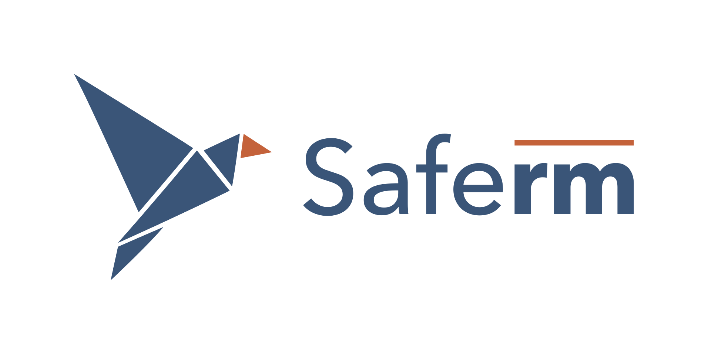
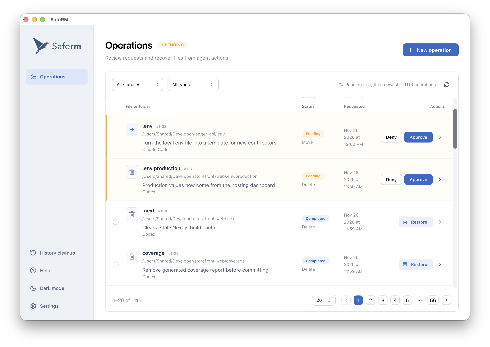
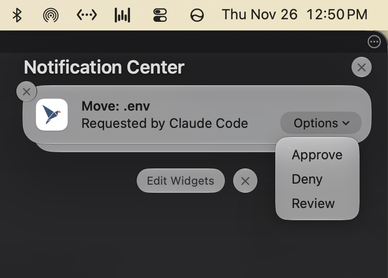

<h1>
  <picture>
    <source media="(prefers-color-scheme: dark)" srcset="images/saferm-logo-horizontal-dark.svg">
    
  </picture>
</h1>

[Overview](#overview) | [Demo](#demo) | [Install](#install) | [Agent Instructions](#agent-instructions) | [Monitor and restore](#monitor-and-restore) | [Configuration](#configuration) | [Recovery and permanent deletion](#recovery-and-permanent-deletion) | [Commands](#commands) | [Documentation](#documentation)

## Overview

SafeRM gives AI coding agents a safer alternative to `rm` and `mv`, with a dedicated agent "trash bin."

Your agent can run `saferm delete` or `saferm move` like any other shell command.

- A delete moves the item to a trash directory and records where it came from.
- A move records the item's original location and—when necessary—makes overwrites restorable so that no action is permanently destructive.
- Each action is recorded with the agent's stated reason, so that it can be reviewed and restored later if necessary.
- Review rules add a measure of protection for sensitive paths, by holding a move or delete until you explicitly approve or deny it.

SafeRM runs on macOS, Linux, and Windows, and comes in a CLI or GUI app.

- **`saferm`**: CLI utility for both agents and humans.
- **SafeRM App**: Desktop app for reviewing requests and managing recovery.
- **SafeRM Notify**: For optional notifications on requests held for approval.

The CLI and the desktop app have full feature parity. Agents use the CLI, while users can use either one to monitor actions, decide pending requests, and restore items.

**Note**: SafeRM does not intercept `rm`, `mv`, or any other commands. Only deletes and moves made through `saferm` are recoverable, so tell your agent to use it.

To block direct use of `rm`, `mv`, or other destructive commands, refer to your agent harness documentation.

- **Claude Code**: [https://code.claude.com/docs/en/permissions](https://code.claude.com/docs/en/permissions)
- **Codex**: [https://learn.chatgpt.com/docs/permissions](https://learn.chatgpt.com/docs/permissions)
- **Other**: refer to your specific agent harness documentation for permission configurations.

**SafeRM protects every delete and move without any configuration.** When an agent runs `saferm delete` or `saferm move`, the action completes immediately and nothing is permanently destroyed. You can restore the item with `saferm restore` or the app's **Restore** button.

For extra protection, you can configure glob patterns for sensitive locations. A delete or move that matches a pattern is held as `pending` until you approve or deny it.

To set up review rules, run `saferm config --setup` to create `~/.saferm/config.toml`, then add your patterns to its `require-review` array:

```toml
require-review = ["~/.*", "**/.git/", ".env*"]
```

You can also add them under **Settings** in the desktop app. [Reviewing requests](docs/user-docs/review.md) describes the pattern syntax.

## Demo


The desktop app's **Operations** page lists pending requests first, with **Deny** and **Approve**. Completed actions have **Restore**:



SafeRM Notify shows each pending request as a desktop notification:



## Install

### macOS and Linux

```sh
curl -fsSL https://github.com/shdeen/saferm/releases/latest/download/install.sh | sh
```

Requires `curl` or `wget` for downloads and `sha256sum` or `shasum` for verification.

| System | Installer behavior |
| --- | --- |
| macOS 13 or later, Intel or Apple Silicon | Installs `/Applications/SafeRM.app` and links `/usr/local/bin/saferm` to the CLI inside the app. |
| Ubuntu 24.04 or a compatible APT system | Installs the DEB package and its runtime dependencies. |
| Fedora 44 or a compatible DNF system | Installs the RPM package and its runtime dependencies. |

### Windows

Run this in PowerShell 5.1 or later:

```powershell
irm https://github.com/shdeen/saferm/releases/latest/download/install.ps1 | iex
```

The installer adds SafeRM to your `PATH`, including in the current PowerShell session, and installs WebView2 if it is missing.

### After installation

Open SafeRM once from your applications menu. Its first launch sets the notifier to start when you log in. On macOS, approve the login item and notifications in System Settings if asked.

### Install the CLI only

The CLI works without the desktop app and the notifier. To install only the CLI, [install Go](https://go.dev/dl/) 1.27 or later, then run:

```sh
go install github.com/shdeen/saferm/cmd/saferm@latest
```

See [Installation](docs/user-docs/installation.md) for installing specific versions, other install locations, package downloads, upgrading, and uninstalling.

## Agent Instructions

Add this to your agent's instruction file, such as `AGENTS.md` or `CLAUDE.md`:

```markdown
Use `saferm` for file deletes and moves. It keeps them recoverable.

- Delete: `saferm delete "<path>" "<reason>"`
- Move: `saferm move "<source>" "<destination>" "<reason>"`
- The reason should say why the change is needed.
- A `pending` result means the path needs the user's approval. Report the action ID to the user.
- Use `saferm help` for full usage instructions.
```

See [Agent setup](docs/user-docs/agents.md) for what the agent gets back and how to block direct `rm` and `mv`.

## Monitor and restore

The desktop app's **Operations** page lists every action with its path and reason, with pending requests first. From there you can approve or deny a pending request, restore an item to its original path, and permanently delete items from trash.

The CLI does the same:

```sh
saferm list                     # all actions
saferm list --status pending    # requests waiting for your decision
saferm view <id>                # one action's details
saferm restore <id>             # undo a delete or move
saferm dispose <id> approve     # or: saferm dispose <id> deny
```

## Configuration

SafeRM's settings live in `~/.saferm/config.toml`. Run `saferm config --setup` to write the file with the built-in values, then edit it, or use the desktop app's **Settings** page. `saferm config` shows the settings in effect.

| Setting | What it does |
| --- | --- |
| `trash-path` | Directory that deleted items go to. Initially `~/.saferm/trash`. |
| `retain-period` | Days that a resolved action stays in history before `saferm cleanup` can remove its record. It never erases items from trash. |
| `require-review` | Patterns for sensitive paths that need your approval. |

See [Configuration](docs/user-docs/configuration.md) for details.

## Recovery and permanent deletion

- To restore an item to a path that a new item now occupies, use `saferm restore --overwrite`, or **Allow replacement at the original path** in the desktop app. The new item goes to trash first.
- `saferm purge <id>...` permanently erases deleted items from trash. It does not ask for confirmation, and it cannot be undone through SafeRM.
- `saferm cleanup` removes history records according to `retain-period`. It never removes files. Once a completed move's record is removed, SafeRM can no longer reverse that move.

Read [Recovery and history](docs/user-docs/recovery.md) before you purge trash or clean up history.

## Commands

| Command | Purpose |
| --- | --- |
| [`delete`](docs/user-docs/cli.md#delete) | Move an item into recoverable trash. |
| [`move`](docs/user-docs/cli.md#move) | Move an item to a recorded destination. |
| [`list`](docs/user-docs/cli.md#list) | List action history. |
| [`view`](docs/user-docs/cli.md#view) | Show one action's details. |
| [`dispose`](docs/user-docs/cli.md#dispose) | Approve or deny a pending action. |
| [`restore`](docs/user-docs/cli.md#restore) | Return an item to its original path. |
| [`purge`](docs/user-docs/cli.md#purge) | Permanently erase one or more deleted items. |
| [`cleanup`](docs/user-docs/cli.md#cleanup) | Remove eligible history records. |
| [`config`](docs/user-docs/cli.md#config) | Display, create, or reset configuration. |
| [`help`](docs/user-docs/cli.md#help) | Show general or command-specific help. |

Run `saferm help <command>` or `saferm <command> -h` for a command's syntax and options.

## Documentation

The [documentation index](docs/user-docs/index.md) groups every page by purpose.

- [Overview](docs/user-docs/overview.md)
- [Quickstart](docs/user-docs/quickstart.md)
- [Installation](docs/user-docs/installation.md)
- [Agent setup](docs/user-docs/agents.md): instructions for your agent, its results, and blocking direct `rm` and `mv`.
- [How deletes and moves work](docs/user-docs/file-operations.md): trash, recoverable overwrites, paths, and moves between filesystems.
- [Reviewing requests](docs/user-docs/review.md): review rules and deciding pending requests.
- [Recovery and history](docs/user-docs/recovery.md): restoring items, statuses, purging trash, and cleaning up history.
- [Configuration](docs/user-docs/configuration.md): settings and the trash location.
- [Command-line reference](docs/user-docs/cli.md): commands, options, confirmations, and exit status.
- [CLI output and JSON reference](docs/user-docs/cli-output.md): JSON fields and result shapes.
- [Desktop app reference](docs/user-docs/desktop.md): pages, controls, and settings.
- [Notifications](docs/user-docs/notifications.md): starting the notifier, notification actions, and diagnostics.
- [Troubleshooting](docs/user-docs/troubleshooting.md): error messages and interrupted operations.

Revised 2026-11-26
